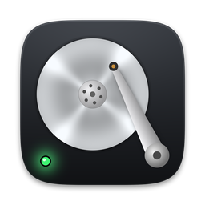
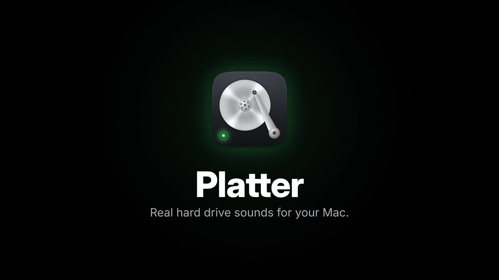

<p align="center"></p>

<h1 align="center">Platter</h1>

<p align="center"><b>Real hard drive sounds for your Mac.</b><br>
A tiny menu bar app that gives your silent SSD the grind, the clicks and the spin up of a mechanical drive, driven by what your Mac is actually doing.</p>

<p align="center">
  <a href="https://github.com/hurtz/platter/releases/latest/download/Platter.zip"><b>Download free</b></a> &nbsp;·&nbsp;
  <a href="https://hurtz.github.io/platter/">Watch the demo</a> &nbsp;·&nbsp;
  macOS 13 or later &nbsp;·&nbsp; Apple Silicon and Intel
</p>

<p align="center"><a href="https://hurtz.github.io/platter/"></a></p>

## What it does

Flip one switch in your menu bar and your Mac has a hard drive again.

* **Six drives:** 3.5″ floppy, 5.25″ floppy, a 1986 MFM stepper drive, a 1995 IDE drive, a 7200 RPM desktop drive and a 15K RPM server drive.
* **It listens.** In Live mode Platter reads the same disk counters Activity Monitor shows and turns every burst of real reads and writes into seeks, settles and rotational waits, the way a real drive would service them. Copy a big folder and it grinds. Leave your Mac alone and it mostly hums.
* **Ambient and Busy modes** simulate an idle 1997 PC or a heavy install, if you just want the vibe.
* **A real activity light.** The icon in your menu bar blinks green for reads and amber for writes, in sync with the sound.
* **Spin up, calibration and head parking** when you switch it on and off. The floppies do the old power on "brrrt, chunk" check.
* **Nothing is a recording.** Every sound is synthesized live, so no two seeks sound the same.
* No accounts, no network access, no tracking. It reads disk activity counters and makes noise. That's it.

## Install

1. [Download Platter.zip](https://github.com/hurtz/platter/releases/latest/download/Platter.zip) and unzip it.
2. Drag **Platter** into **Applications**.
3. Open it. Platter isn't signed through Apple's paid developer program yet, so macOS may say it can't verify the developer. Open **System Settings › Privacy & Security**, scroll down and click **Open Anyway**. Or paste this into Terminal:

   ```sh
   xattr -dr com.apple.quarantine /Applications/Platter.app
   ```

4. Click the little drive in your menu bar and flip the switch. Right click the icon any time to turn it on or off.

## Build it yourself

You need the Xcode command line tools (`xcode-select --install`). Then:

```sh
git clone https://github.com/hurtz/platter.git
cd platter
./build.sh            # builds a universal app, zips it into dist/, installs to /Applications and opens it
./build.sh --no-install   # just build
```

No Xcode project, no dependencies. `build.sh` compiles the C sound engine and the Swift app with `clang` and `swiftc`.

## How it's put together

| File | What it is |
| --- | --- |
| `Sources/DriveSynth.c` | The sound engine. Pure C, allocation free in the audio thread. Spindle motor and bearings, voice coil and stepper actuators, modal resonators for the arm and chassis, floppy motor and media swish, and a small state machine that services reads and writes like a real drive. **All six drives are just parameter blocks at the top of this file.** |
| `Sources/Audio.swift` | Hosts the engine in an `AVAudioEngine` source node, and polls IOKit disk statistics. |
| `Sources/PanelView.swift`, `DriveArt.swift` | The SwiftUI panel and the animated drive drawings. |
| `Sources/StatusIcon.swift` | The menu bar icon with its activity LED. |
| `tests/` | Offline renders. `render_test.c` builds with any C compiler on any OS and writes a WAV per drive, so you can tune sounds without a Mac. |

## Come make it better

This started as a "wouldn't it be cool if" and turned out way better than expected. It can get a lot cooler with more ears on it. Ideas that would be awesome:

* An Iomega Zip drive, click of death included
* CD-ROM spin up, tray and seek whine
* Laptop drives that park their heads every few seconds
* Tape drives, Amiga floppies, a Commodore 1541 head knock
* User made drive profiles and per drive volume
* Signed and notarized builds, auto updates

Open an [issue](https://github.com/hurtz/platter/issues) with an idea, or send a pull request. See [CONTRIBUTING.md](CONTRIBUTING.md) for how to tune a drive.

## Credits

Made by [Jason O'Connell](https://github.com/hurtz). Released under the [MIT license](LICENSE).
